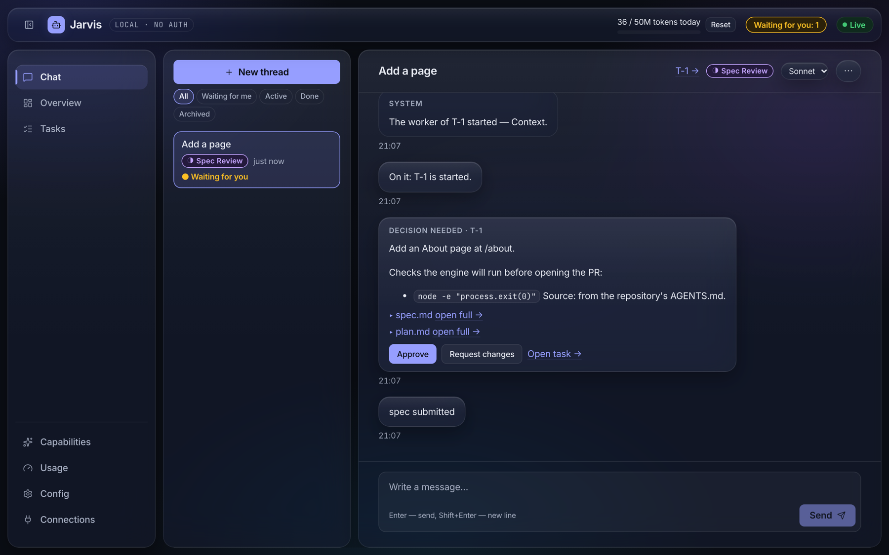
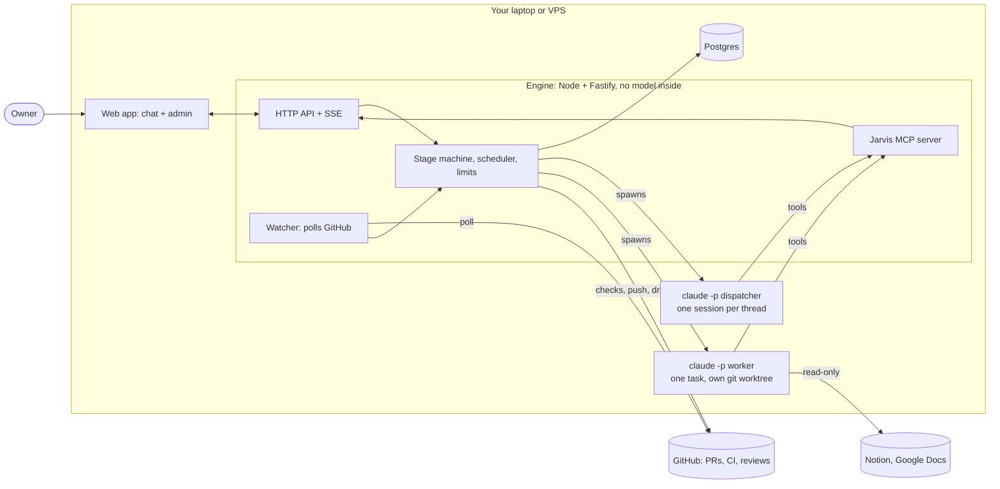

# Jarvis

**A personal AI development agent: a task in chat becomes a spec, a plan, code, checks, a review and a draft
pull request.** It runs on your own machine (a laptop or a small VPS) through your Claude Code subscription:
no API key, no hosted service.

You describe a task in the web chat. Jarvis gathers context (the repository, Notion, Google Docs), writes a
spec and waits for your approval, implements the change in an isolated git worktree, runs the checks, has the
result reviewed and opens a **draft PR**. It then watches CI and review comments and fixes what they report.
Jarvis never merges; that stays with a human.

[Slides](https://burnjohn.github.io/jarvis-agent/) (Ukrainian) · [Architecture](docs/architecture/README.md) ·
[Decisions](docs/decisions/architecture/README.md) · [Status](STATUS.md)



The chat after the agent has written a spec and a plan: it asks for approval and lists the checks the engine
will run before opening the PR (demo data). More on how it is built:
[`docs/architecture/README.md`](docs/architecture/README.md).

## How it works

The **engine** is a plain Node process that owns all state. Claude only thinks: it is started as `claude -p`
for each owner message (the _dispatcher_) and for each task stage (the _worker_), and it changes state only
through the tools of the engine's MCP server.



The model has no GitHub token and cannot write to the database. The engine runs the checks itself and refuses
to open a PR while they are red, so a red result cannot reach a pull request however the model words its
report.

## Highlights

- **Spec first.** Every task goes through a written spec and plan that you approve before any code is written.
- **Isolated and reviewable.** One git worktree per task, a folder of artifacts per stage, a full run console.
- **Safe by construction.** Subscription only (the engine refuses to start with `ANTHROPIC_API_KEY`), limits on
  turns, cost and tokens, untrusted external content wrapped and reported, loopback-only servers.
- **Self-curating memory.** What the agent learns about you goes into one file that you review.
- **Runs anywhere.** Secrets in Infisical, Tailscale instead of open ports, deployable to a small VPS.

## Quick start

Prerequisites: Node 22, pnpm 10, Docker, and Claude Code (`claude`) logged in with a Claude subscription.

```sh
mkdir -p ~/.jarvis
cp .env.example ~/.jarvis/.env                              # set POSTGRES_PASSWORD (and GITHUB_TOKEN to follow PRs)
cp jarvis.config.example.json ~/.jarvis/jarvis.config.json  # set repo.path to your working repository
export COMPOSE_ENV_FILES=~/.jarvis/.env
docker compose up -d                                        # Postgres on 127.0.0.1:5433
pnpm install
pnpm dev                                                    # engine :4310, web http://127.0.0.1:5180
```

Open http://127.0.0.1:5180 and send a message. Details, the remote-UI setup and the server rehearsal are in
[`docs/running.md`](docs/running.md).

## Documentation

- [`docs/specs/abstract-project-spec.md`](docs/specs/abstract-project-spec.md): what it does
- [`docs/architecture/README.md`](docs/architecture/README.md): how it is built, with the decisions in
  [`docs/decisions/architecture/`](docs/decisions/architecture/README.md)
- [`docs/running.md`](docs/running.md): run it locally, against a server, or rehearse the server
- [`STATUS.md`](STATUS.md): where the project stands
- [`AGENTS.md`](AGENTS.md): instructions for AI coding agents in this repo
