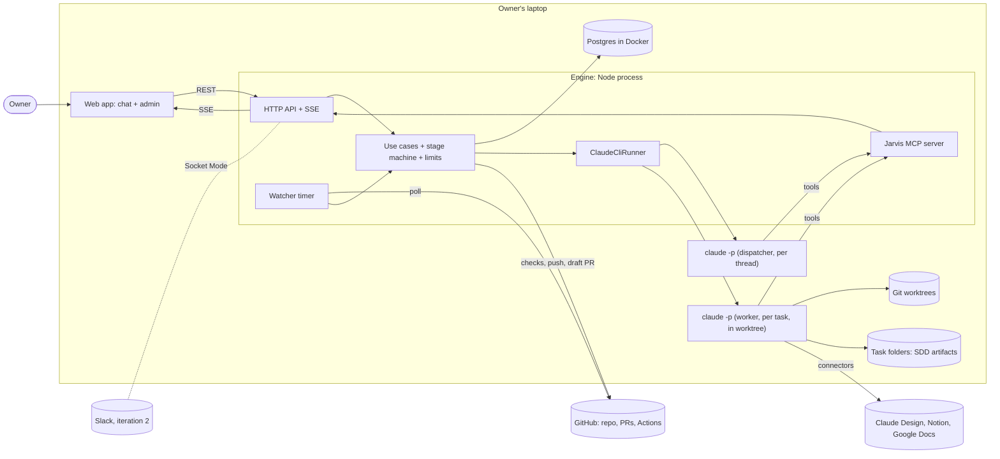
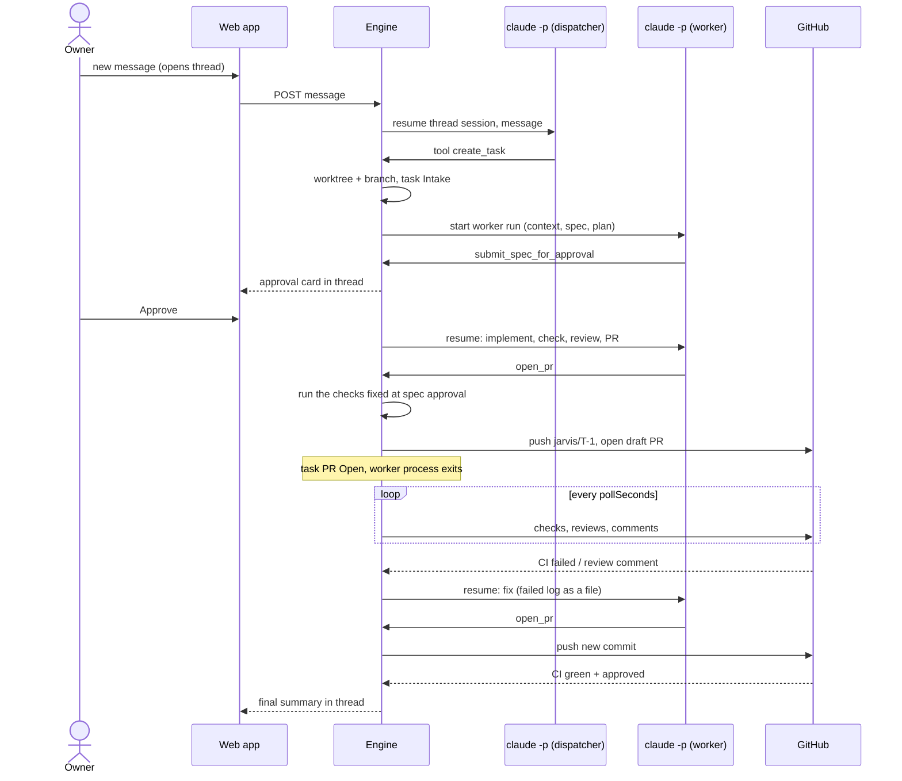

# Architecture

How Jarvis is built. Status: iteration 1 is implemented (engine, web, server readiness); the current
state and the live-proof gaps are in [`../../STATUS.md`](../../STATUS.md). The _why_ behind each choice
is in [`../decisions/architecture/`](../decisions/architecture/README.md) (`accepted`); behaviour is in
[`../specs/abstract-project-spec.md`](../specs/abstract-project-spec.md); the UI brief is in
[`../specs/web-ui-design.md`](../specs/web-ui-design.md).

## System context

Everything runs on one machine: the owner's laptop, or a VPS reached only over Tailscale (ADR-0016).
The engine is one Node process; it spawns `claude` processes and talks to GitHub. Postgres runs in
Docker. Slack arrives in iteration 2.

## Modules

| Module | Path | Purpose |
|---|---|---|
| shared | `shared/` | Zod contracts: HTTP bodies, SSE events, MCP tool inputs, config schema, enums (stages, roles) |
| engine | `engine/` | Onion: domain, application, infrastructure, presentation (ADR-0002) |
| web | `web/` | React SPA: chat + admin |

Engine layers (ADR-0002):

| Layer | Main parts |
|---|---|
| Domain | `Thread`, `Message`, `Task` + stage transitions, `Run`, `Watch`, `PermissionRequest`, `LimitPolicy` |
| Application | Use cases: `PostOwnerMessage`, `StartTask`, `ApproveSpec`, `AnswerQuestion`, `AnswerPermission`, `HandleCodeHostChange`, `ResumeTask`, `CancelTask`, `StopRun`, `RetryStage`; scheduler of worker slots; ports |
| Infrastructure | Drizzle repositories, `ClaudeCliRunner` (spawn, stream-json parse, env allow-list), `GitWorktreeManager`, `GitHubCodeHost` (Octokit), `FileArtifactStore`, config + env loaders, SSE fan-out |
| Presentation | Fastify routes + `/api/stream`, Jarvis MCP server (stdio, per run), watcher timer, Slack adapter (iteration 2) |

## How a task flows

## Process model (ADR-0003)

- **Dispatcher run** per owner message: `claude -p --resume <thread-session> --output-format stream-json`, dispatcher prompt, only Jarvis dispatcher tools.
- **Worker run** per task stage: `claude -p --input-format stream-json --output-format stream-json --verbose`, `cwd` = task worktree, `--max-turns`, `--max-budget-usd`, `--model`, `--mcp-config` (Jarvis tools + connectors), `--permission-prompt-tool mcp__jarvis__approve`, worker settings that deny `git push` and `gh`, and no GitHub token in its environment: the engine runs the checks, pushes and opens the PR (ADR-0022).
- Owner messages to a live worker go to its stdin; otherwise they wait for the next run.
- Every stream-json event is stored in `run_events` and pushed over SSE — that is the admin "console".
- The engine refuses to start with `ANTHROPIC_API_KEY` set and strips provider variables from child env.

## Data (ADR-0008)

Postgres tables (indicative): `threads`, `messages`, `tasks`, `task_events`, `runs`, `run_events`,
`permission_requests`, `watches`, `usage`. Artifacts: `<dataDir>/tasks/<task-id>/*.md`.

## Where agent data lives (ADR-0009)

| What | Where | In git |
|---|---|---|
| Agent definition: `SOUL.md`, role prompts, subagents, skills, SDD templates, permission settings | `agent/` — a Claude Code plugin loaded per run with `--plugin-dir` | yes |
| Owner preferences `USER.md`, `jarvis.config.json`, `.env`, `mcp/servers.json` | `~/.jarvis/` | no (examples only) |
| Worktrees, SDD artifacts, screenshots, per-run `mcp.json`/`settings.json` | `~/.jarvis/worktrees`, `tasks`, `runs` | no |
| Threads, messages, tasks, journal, runs, run events, permissions, watches, usage | Postgres | no |
| Claude session transcripts and the subscription login | `~/.claude` (managed by Claude Code); Jarvis stores only `session_id` | no |
| Project rules and check commands | target repo `AGENTS.md` | target repo |

Runs use `--setting-sources project,local` so the owner's personal `~/.claude` plugins and hooks do not
leak into the agent, and `--mcp-config ... --strict-mcp-config` so only Jarvis and connector servers load.
Visual overview: [`overview.html`](overview.html), published at https://claude.ai/artifact/DwL6g8WNwwMThtbhqgZztn

## Configuration and secrets (ADR-0005, ADR-0015)

- `~/.jarvis/jarvis.config.json` (example committed): repo, limits, models per role, allowlists, connector scopes.
- Secrets live in Infisical (ADR-0015), with `~/.jarvis/.env` as the local fallback (example committed): `GITHUB_TOKEN` of the bot account, `NOTION_TOKEN`, Google OAuth credentials, `DATABASE_URL`, `POSTGRES_PASSWORD`; iteration 2 adds `SLACK_BOT_TOKEN`, `SLACK_APP_TOKEN`.
- Claude: the owner logs in with `claude` once; no key in Jarvis.
- On a server, secrets come from Infisical (ADR-0015); see [`deployment.md`](deployment.md).
- How connectors (Notion, Google Docs) authenticate without a browser on the server: [`connectors.md`](connectors.md).

## Deployment (ADR-0016)

The laptop setup stays the default. For an always-on setup, Jarvis runs on a Hetzner VPS as systemd
services, reachable only over Tailscale: [`deployment.md`](deployment.md).

## Iterations

| Iteration | Adds |
|---|---|
| 1 | engine, Postgres, web chat + admin, dispatcher and worker runs, SDD flow, connectors, GitHub bot + watcher, limits config |
| 2 | Slack adapter with threads (Socket Mode), permission and decision buttons as Block Kit actions |
