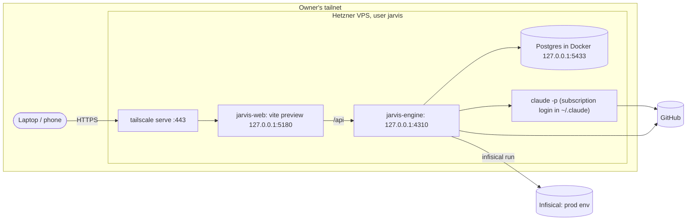

# Deployment

How to run Jarvis on a server (ADR-0016) with secrets from Infisical (ADR-0015). Unit files, the
Infisical wrapper and the `vite preview` block are in [`deploy/`](../../deploy/README.md).



To try the Linux user, Node/pnpm and the headless `claude` login before the server exists, use the laptop
rehearsal in [`docs/running.md`](../running.md) ("Rehearse the server setup", ADR-0016). It does not cover systemd, journald, Tailscale or
the firewall.

## 1. Server

1. Hetzner Cloud → new server: Ubuntu 24.04, 8–16 GB RAM (e.g. CX32/CX42), your SSH key, a firewall with inbound SSH only.
2. As root:
   ```sh
   adduser --disabled-password jarvis                               # NOT in the docker group (see below)
   # Docker Engine, git, gh, Node 22 (nvm or NodeSource), corepack enable (pnpm)
   curl -fsSL https://claude.ai/install.sh | bash                    # as jarvis, Claude Code CLI
   ln -sf /home/jarvis/.local/bin/claude /usr/local/bin/claude      # as root: systemd's PATH has no ~/.local/bin
   curl -fsSL https://tailscale.com/install.sh | sh && tailscale up --ssh
   ```

   **Commit identity.** A worker runs with `GIT_CONFIG_GLOBAL=/dev/null` (ADR-0022), so `git config --global`
   never reaches it. Give the engine unit the identity instead; the engine passes `GIT_AUTHOR_*` and
   `GIT_COMMITTER_*` through to every child `claude`:

   ```sh
   sudo systemctl edit jarvis-engine   # then, in the drop-in:
   # [Service]
   # Environment=GIT_AUTHOR_NAME=Jarvis GIT_COMMITTER_NAME=Jarvis
   # Environment=GIT_AUTHOR_EMAIL=<id>+<login>@users.noreply.github.com GIT_COMMITTER_EMAIL=<id>+<login>@users.noreply.github.com
   ```

   **Never add `jarvis` to the `docker` group.** The Docker daemon runs as root, so whoever can talk to its
   socket can start a container with the host's filesystem mounted and act as root. `jarvis` runs every child
   `claude`, and a worker has `Bash`, so membership would let a prompt injection read the root-only
   `/etc/jarvis/infisical.env` and anything else. Docker is driven as root only: the one-off `compose up`
   below, and any long-lived container a target repository needs (its restart policy keeps it up).
3. Once `tailscale ssh jarvis@<host>` works, remove SSH from the Hetzner firewall.
   **Rootless Docker for the UI check (ADR-0026).** The engine runs each UI check in disposable
   containers, as `jarvis`, through a rootless daemon — which gives a container no more than `jarvis`
   already has, so the rule above stands. Once, as root:
   ```sh
   apt-get install -y uidmap dbus-user-session docker-ce-rootless-extras
   loginctl enable-linger jarvis                      # the user daemon survives logout and reboot
   sudo -iu jarvis dockerd-rootless-setuptool.sh install
   sudo -iu jarvis systemctl --user enable --now docker
   id -u jarvis                                       # <uid> for the drop-in below
   sudo systemctl edit jarvis-engine
   # [Service]
   # Environment=DOCKER_HOST=unix:///run/user/<uid>/docker.sock
   # Environment=XDG_RUNTIME_DIR=/run/user/<uid>
   sudo -iu jarvis DOCKER_HOST=unix:///run/user/<uid>/docker.sock docker run --rm hello-world
   ```
   Without a daemon the engine does not hang: every `start_dev_server` is refused with
   `docker_unavailable` and the pull request says the UI check did not complete.
   Remove the retired keys from `~/.jarvis/jarvis.config.json` (`ui.devCommand`, `ui.baseUrl`,
   `ui.readyPath`, `ui.allowedOrigins`, `ui.env`) and delete `~/.jarvis/ui/`; the engine ignores them
   with a warning until then.
   _Open:_ the check network may still reach private addresses (RFC1918, the tailnet). Dropping that
   egress needs host firewall rules for the rootless network namespace and is not set up yet.
4. Chromium for the UI check (ADR-0014), as root, into a path `jarvis` can read:
   ```sh
   export PLAYWRIGHT_BROWSERS_PATH=/ms-playwright
   # the version Playwright MCP depends on (ARG PLAYWRIGHT_VERSION in docker/runtime/Dockerfile); another
   # version installs a Chromium revision the MCP does not look for
   npx --yes playwright@1.65.0-alpha-2026-10-30 install --with-deps chromium && chmod -R a+rX /ms-playwright
   ```
   Then put `PLAYWRIGHT_BROWSERS_PATH=/ms-playwright` in the engine unit's environment, and set
   `ui.noSandbox: true` in `jarvis.config.json` — the server has no user namespaces for Chromium's
   sandbox. Skipping this step is allowed: the UI check then reports `inconclusive` and the PR says so.
   Adds roughly 400 MB.

## 2. Claude login (once, interactively)

```sh
tailscale ssh jarvis@<host>
claude            # then /login, open the printed URL on your laptop, paste the code back
claude -p "ping"  # must answer without ANTHROPIC_API_KEY
```

## 3. Secrets (Infisical)

1. Infisical → project `jarvis`, environments `dev` and `prod`, variables as in [`.env.example`](https://github.com/burnjohn/jarvis-agent/blob/main/.env.example).
2. Organization → Machine identities → `jarvis-vps`, Universal Auth, read-only role on `prod`.
3. On the server, as root:
   ```sh
   install -d -m 0755 -o root -g root /etc/jarvis
   install -m 0600 -o root -g root /dev/null /etc/jarvis/infisical.env
   printf 'INFISICAL_CLIENT_ID=...\nINFISICAL_CLIENT_SECRET=...\nINFISICAL_PROJECT_ID=...\n' > /etc/jarvis/infisical.env
   ```

   The file is `root:root 0600`: systemd reads `EnvironmentFile=` as root, and a child `claude` running as `jarvis` must not be able to read the long-lived client secret.
4. Install the Infisical CLI on the server and on the laptop. Laptop: `infisical login && infisical run --env=dev -- pnpm dev`.
5. Postgres password (ADR-0015): generate one (`openssl rand -base64 24`), store it in Infisical as
   `POSTGRES_PASSWORD` and inside `DATABASE_URL` / `DATABASE_URL_TEST`. `compose.yaml` carries no
   default and refuses to start without it. On a volume created with the old default:
   `sudo docker compose exec postgres psql -U jarvis -c "ALTER USER jarvis PASSWORD '<new>'"`, then restart
   the engine. The local fallback is the same variables in `~/.jarvis/.env`; keep that file an export
   of Infisical (`infisical export --env=dev`), not a second source of truth.

## 3a. Connectors

Notion and Google credentials are Infisical variables, never an interactive login on the server; the order of
preference and the one SSH-tunnel fallback are in [`connectors.md`](connectors.md).

## 4. App

```sh
tailscale ssh jarvis@<host>
git clone https://github.com/burnjohn/jarvis-agent.git ~/jarvis && cd ~/jarvis
mkdir -p ~/.jarvis && cp jarvis.config.example.json ~/.jarvis/jarvis.config.json   # set repo.path, limits
# POSTGRES_PASSWORD has no default (ADR-0015); it comes from Infisical through the machine identity,
# which only root can read; Docker is root-only too, so compose runs as root with that EnvironmentFile:
sudo systemd-run --quiet --wait --pipe --collect --same-dir \
  -p EnvironmentFile=/etc/jarvis/infisical.env scripts/with-secrets.sh docker compose up -d
pnpm install --frozen-lockfile && pnpm --filter @jarvis/web build
```

The server keeps no `~/.jarvis/.env`: every secret, the database URL included, comes from Infisical `prod`.
`scripts/deploy.sh` runs its migrations the same way.

A redeploy never touches the database: `scripts/deploy.sh` does not call Docker, Postgres keeps its data in the
`pgdata` volume, and migrations are additive (ADR-0008). Only `docker compose down -v` (never part of any script
here) deletes that volume.

The units are `deploy/systemd/jarvis-engine.service` and `jarvis-web.service`; the wrapper is `scripts/with-secrets.sh`
(logs in to Infisical with the machine identity and runs `infisical run --env=prod -- <cmd>`; without
`INFISICAL_CLIENT_ID` it runs the command unchanged). Install:

```sh
sudo cp deploy/systemd/jarvis-*.service /etc/systemd/system/ && sudo systemctl daemon-reload
```

`After=docker.service` does not mean Postgres accepts connections. The unit's start gate
(`scripts/wait-healthy.sh`) accepts 503 as "alive, database down", so the engine is not killed while Postgres comes up.

Then `systemctl enable --now jarvis-engine jarvis-web` and `tailscale serve --bg 5180`. Open
`https://<host>.<tailnet>.ts.net` from any device in your tailnet.

## 5. Update

From the laptop, over Tailscale SSH:

```sh
export JARVIS_HOST=<server name>   # or JARVIS_HOST=<server name> in ~/.jarvis/.env; there is no default
pnpm run redeploy                  # the usual way: see below
```

`pnpm run redeploy` (`scripts/redeploy.sh`) is the manual redeploy in one command. It resolves `origin/main` on
GitHub, shows the commits that are about to go out, waits for live runs to finish so a working agent is not cut
off mid-turn (up to 10 minutes; `-- --wait 30` to wait longer, `-- --now` to interrupt them — they resume after
the restart), runs `/usr/local/sbin/jarvis-deploy <sha>` on the server, then checks `/api/health` and the units
and prints the commit that is live. `-- --check` only shows what would be deployed and whether a run is live.
With nothing new on `main` it restarts the same commit. `JARVIS_HOST` (a name, or `user@name`; `root@` is assumed)
is required: no host name is committed to the repository.

`jarvis-deploy` is a root-owned script outside the checkout (`deploy/root/jarvis-deploy`, installed once, §7). The
checkout is writable by `jarvis` (worker Bash, check commands, a container escape), so root must never execute
anything from it. The script validates the 40-hex SHA, checks it equals GitHub's current `refs/heads/main`, then
does `git fetch` + `git reset --hard <sha>` (main's history was rewritten, so ff-only no longer applies), install,
build and migrate as `jarvis` (`runuser`, and a transient unit that lends the migration the root-only Infisical
file), and as root only the lock, `systemctl restart` and an inlined copy of the `wait-healthy.sh` check. The old
`deploy:remote` script is removed: it ran the checkout's `deploy.sh` as root.

`pnpm run deploy` (rehearsals, or `jarvis` with a sudo rule; never as root) runs [`scripts/deploy.sh`](../../deploy/README.md#deploy-script), which wraps the exact sequence
above (pull, install, build, migrate, restart) behind one lock-protected command. Use `pnpm run deploy`, not
`pnpm deploy` — the bare form is pnpm's own built-in `deploy` subcommand (for packaging a workspace project), not
this repo's script.

## 6. Backups

Hetzner automatic backups (daily snapshot of the whole disk) cover Postgres, `~/.jarvis` and `~/.claude`.
After a restore, check `claude -p "ping"`; log in again if the session expired.

## 7. Hardening runbook (H2 egress, H3 root deploy)

One-time, owner-run steps on the server, as root (`sudo -i` or `tailscale ssh root@<host>`), from the checkout
(`cd /home/jarvis/jarvis`). The checkout is jarvis-writable, so **review the files you are about to run**
(`git log -3 -- deploy/`, read the scripts) or copy them out of a commit you trust first.

**Order:** `git pull` (as jarvis; the deploy path before H3 is the old one) → H3 install → H2 install → verify.

### H3: root-owned deploy entrypoint

```sh
deploy/root/install-root-deploy.sh      # install -o root -g root -m 0755 → /usr/local/sbin/jarvis-deploy
```

Test from the laptop with `pnpm run redeploy -- --check`, then a real `pnpm run redeploy`. Updating the entrypoint
is always an explicit re-run of that installer by the owner; a deploy never replaces it.

### H2: egress filter and container DNS

First check how the host resolves names: `resolvectl status` and `cat /etc/resolv.conf`. Normally it points at
systemd-resolved (`127.0.0.53`, loopback, unaffected). If it points straight at MagicDNS (`100.100.100.100`),
the filter still allows port 53 to MagicDNS (and `fd7a:115c:a1e0::53`) so the engine keeps resolving; everything
else on the tailnet stays dropped.

```sh
deploy/hardening/egress.sh              # nftables table + jarvis-egress.service + rootless docker daemon.json
export JARVIS_TAILNET_NAME=<this host's tailnet name, see `tailscale status`>
deploy/hardening/verify-egress.sh
```

What it does. A persistent nftables table `inet jarvis_egress` (hook `output`) is loaded at boot by
`jarvis-egress.service` (which runs `/usr/local/sbin/jarvis-egress load`, so the host's own addresses are
resolved at every boot; re-run the installer after an address change). For `meta skuid jarvis` it accepts loopback,
established traffic and an optional `EGRESS_EXTRA_ALLOW` list, and drops `100.64.0.0/10`, `10.0.0.0/8`,
`172.16.0.0/12`, `192.168.0.0/16`, `169.254.0.0/16`, `fd7a:115c:a1e0::/48`, `fc00::/7`, `fe80::/10` and the host's
own global IPv4/IPv6 addresses. Rootless Docker sends container traffic out of the host namespace as uid `jarvis`
(slirp4netns/pasta), so containers are covered too; root, `tailscaled`, `systemd-resolved`, `alloy` and `sshd` run
as other uids and are not affected, so SSH over Tailscale and `tailscale serve` keep working. Public resolvers
need no rule (public ranges are allowed). It also writes `~jarvis/.config/docker/daemon.json` (merged with
`jq`, backup kept) with `"dns": ["1.1.1.1", "9.9.9.9"]` and `"dns-search": []`, and restarts the user's Docker
(Postgres is briefly down; the engine reports 503 and recovers). Existing containers keep their old
`resolv.conf` until recreated: `docker compose up -d --force-recreate` as `jarvis`.

Assumption: the engine and its children need nothing in the blocked ranges. Postgres, the web preview and
Alloy's OTLP are on loopback; GitHub, npm, Docker Hub, Infisical, healthchecks.io and the Anthropic API are
public. A target repo whose checks need a private host: put that single address in `EGRESS_EXTRA_ALLOW="ip ip"` in the
root-owned `/etc/default/jarvis-egress` (the installer creates it empty only if absent and never overwrites it),
then `systemctl restart jarvis-egress`; the boot-time `load` reads it every time.

Verification (`verify-egress.sh`, the same checks by hand as `jarvis` with `DOCKER_HOST` set): from a throwaway
container, `curl https://<tailnet name>/api/health`, `curl http://100.100.100.100/` and
`curl http://169.254.169.254/` must fail; `curl https://registry.npmjs.org/` and `docker pull node:22-bookworm`
must work; as `jarvis` on the host `getent hosts github.com`, `getent hosts registry.npmjs.org` and
`curl https://api.github.com` must work too; `curl http://127.0.0.1:4310/api/health` on the host must still return 200.

Rollback: `deploy/hardening/egress.sh remove` (or just `nft delete table inet jarvis_egress`; it returns on the
next boot unless the unit is disabled). It leaves `daemon.json` alone; remove the two keys to revert DNS.

### Known residual risk

Rootless Docker still runs as uid `jarvis`, the same uid as the engine and worker sessions, so a container
escape owns `jarvis` (its `~/.claude` login, the checkout, the Postgres volume) even though it can no longer
reach the tailnet or root. Next step: run Docker under a dedicated uid with no access to `jarvis`' files, and
have the engine talk to it over a socket. Until then the egress filter and the root-owned deploy limit the
blast radius; they do not remove it.
